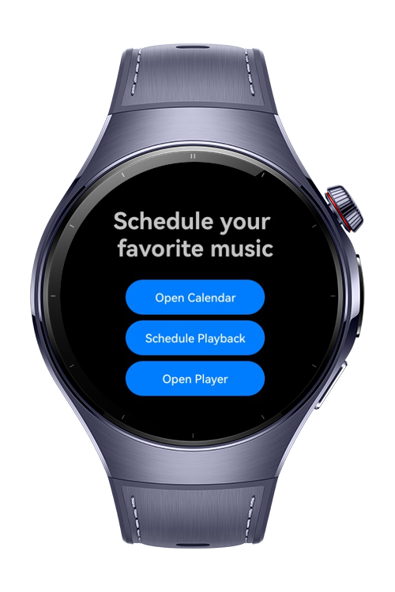
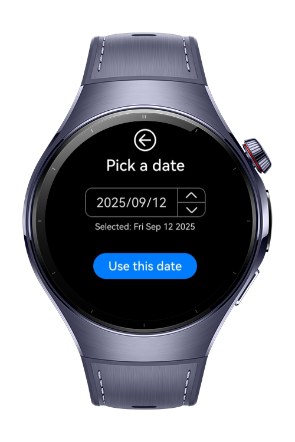
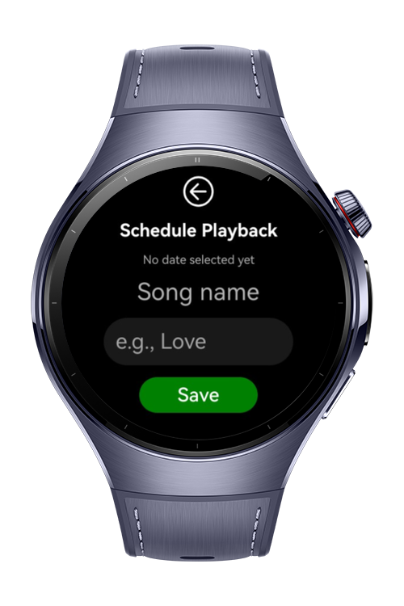
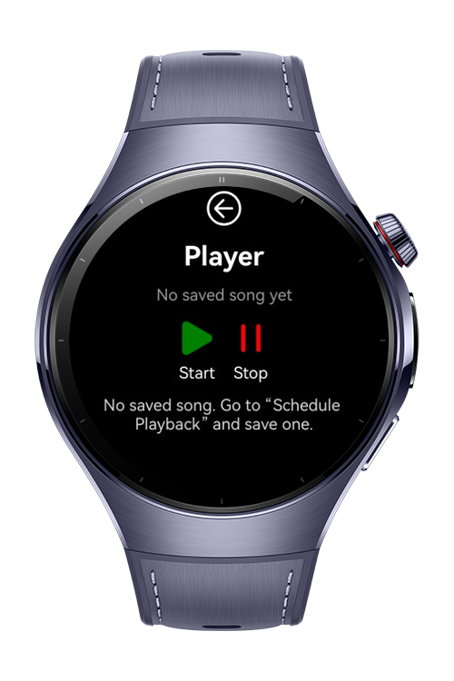

> **Note:** To access all shared projects, get information about environment setup, and view other guides, please visit [Explore-In-HMOS Index](https://github.com/Explore-In-HMOS/hmos-index).

# Smart Music Scheduler

This HarmonyOS app lets users schedule a song to play automatically at a specific date and time. You pick a date/time, choose a track, and save. When the moment arrives, a background trigger starts playback and can optionally show a notification with Play / Stop / Snooze actions. The goal is a hands-free experience for reminders, routines, and moments you don’t want to miss.

# Preview
<div>




</div>

# Use Cases

- **Scheduling Demo**: Associate a date/time with a song title in a minimal flow.

- **Player Stub**: Start/Stop wired to an AudioFacade placeholder for rapid prototyping.

- **Navigation Sample**: Demonstrate push/back/replace flows using the ArkUI Router.

- **Background Scheduling**: Show time-based triggers using BackgroundTask Kit.

- **Calendar Integration**: Mirror schedules as events via CalendarKit (create/read).

- **Notification Actions**: Expose Play/Stop/Snooze from a system notification at trigger time.

# Technology

## Stack
**Languages**: ArkTS

**Framework**: HarmonyOS SDK 5.1.0(16)

**Tools**: DevEco Studio Version 5.1.0.842

**Libraries/Kits**: ArkUI Kit, Calendar Kit, PerformanceAnalysisKit, BackgroundTask Kit, Audio Player Kit
## Required Permissions
- `ohos.permission.READ_CALENDAR`
- `ohos.permission.WRITE_CALENDAR`
- `ohos.permission.PUBLISH_AGENT_REMINDER`
- `ohos.permission.READ_HEALTH_DATA`
- `ohos.permission.MEDIA_LOCATION`
<br/>

# Directory Structure
```
SmartMusicSchedulerApp/
├── entry/
│   └── src/main/ets/
│       ├── entryability/
│       │   ├── EntryAbility.ets              
│       │   └── EntryBackupAbility.ets       
│       ├── pages/
│       │   ├── WelcomePage.ets               # Initial screen
│       │   ├── Index.ets                     # Hub: Calendar / Schedule / Player
│       │   ├── CalendarPage.ets              # Date selection (CalendarPicker)
│       │   ├── SchedulePage.ets              # Save date + song title
│       │   └── PlayerPage.ets                # Start/Stop via AudioFacade
│       └── services/
│           └── ScheduleStore.ets             # In-memory state (date/title/latest)
```
<br/>

# Constraints and Restrictions

## Supported Device
- Huawei Watch 5

# License
**SmartMusicScheduler** is distributed under the terms of the **MIT License**.
See the [LICENSE](/LICENSE) for more information.